# User-authorized web forms implementation plan

## 1. Objective

Extend PrivacyFill AI from two automatically supported localhost pages to user-authorized standard
HTTP/HTTPS forms, including a tested subset of Google Forms, without granting continuous access to every
page and without weakening the rule that raw profile values never reach the planner.

The feature should work like this:

1. The user opens a form in Chrome.
2. The user clicks the PrivacyFill AI extension on that tab.
3. Chrome grants temporary `activeTab` access because of that user gesture.
4. The extension verifies that the page is eligible and injects its packaged content scanner on demand.
5. The page is scanned locally and the user sees the detected categories.
6. Only a minimized, redacted and leak-checked planning request reaches the localhost backend.
7. The returned typed actions are checked against a fresh live scan.
8. Raw profile values are resolved locally and inserted only after required approval.
9. Final submission remains a separate explicit user decision.

This is an expansion of the current MVP, not a promise that every form on every website will work.

## 2. Recommended permission model

### Selected approach: temporary current-tab access

Keep these Manifest V3 permissions:

```json
{
  "permissions": ["activeTab", "scripting", "storage"],
  "host_permissions": ["http://localhost:8787/*"]
}
```

Do not add `<all_urls>` to `host_permissions` and do not register an all-sites static content script.
Instead, inject `content.js` only after the user opens the extension on the current tab:

```js
await chrome.scripting.executeScript({
  target: { tabId, allFrames: false },
  files: ["content.js"],
});
```

This provides a narrower story for users and judges:

- no continuous background scanning;
- no access to tabs the user did not invoke the extension on;
- no browser-history collection;
- access naturally ends when the tab navigates away or closes;
- localhost backend access remains explicit and unchanged.

### Unsupported page schemes

Fail before injection on:

- `chrome://`, `chrome-extension://` and other browser internal pages;
- the Chrome Web Store and browser-managed viewers;
- `view-source:`, `data:` and extension pages;
- local `file://` pages in the first release;
- non-HTTP(S) URLs;
- cross-origin iframe contents.

Local HTML files can be added later with a separate `file:///*` optional permission and the Chrome
“Allow access to file URLs” toggle. They are not required for normal web or Google Forms support.

## 3. Target support levels

### Level 1 — Standard native HTML forms

Required for the first release:

- `<input>` types text, email, tel, date and number;
- `<textarea>`;
- native `<select>`;
- native checkbox and radio inputs;
- explicit labels, wrapping labels, ARIA labels/references, placeholders and safe names;
- React/Vue/Angular-controlled native fields when normal value setters and input/change events work;
- forms whose field order and visual layout differ from the controlled demos.

### Level 2 — Tested Google Forms subset

Required after Level 1 is stable:

- short-answer and paragraph fields;
- email, phone, name, address and identifier questions with recognizable accessible text;
- date inputs where represented by compatible native controls;
- required-state detection;
- section changes followed by an explicit rescan;
- safe refusal for unsupported controls.

### Level 3 — Custom ARIA widgets

Optional after the hackathon:

- `role="textbox"`, `radio`, `checkbox`, `combobox` and `listbox` widgets;
- open shadow roots;
- site adapters for stable, explicitly tested providers.

Custom widgets must not be simulated with arbitrary clicks returned by the planner. Each widget type needs
its own local adapter, validation rules, tests and post-action verification.

## 4. Architecture changes

```mermaid
flowchart LR
    TAB[User-selected HTTP/S tab] --> ELIG[URL and frame eligibility check]
    ELIG --> INJECT[On-demand packaged scanner injection]
    INJECT --> SCAN[Generic scanner + optional site adapter]
    SCAN --> LABEL[Label minimizer and PII redactor]
    LABEL --> LEAK[Exact/normalized profile leak checker]
    LEAK --> API[Local planner API]
    API --> PLAN[Typed plan]
    PLAN --> RESCAN[Fresh live rescan + action validation]
    RESCAN --> LOCAL[Local profile resolution and native fill]
    LOCAL --> REVIEW[Submission confirmation]
```



The optional remote planner still receives requests only through the local backend. It never receives a
page URL, browsing history, cookies, account identity, current field values or the local profile object.

## 5. Work chunks

### Chunk A — Page eligibility and on-demand injection

Files:

- `extension/src/core/page-eligibility.js` (new)
- `extension/src/core/content-injector.js` (new)
- `extension/src/popup.js`
- `extension/src/content.js`
- `extension/manifest.json`
- `tests/unit/page-eligibility.test.js` (new)
- `tests/unit/content-injector.test.js` (new)
- `tests/unit/extension-manifest.test.js`

Implementation:

1. Query the active tab from the popup.
2. Accept only `http:` and `https:` pages, including localhost.
3. Reject browser/internal/store URLs with a precise safe error.
4. First send a lightweight `PING_CONTENT_SCRIPT` message.
5. If there is no receiver, inject the packaged `content.js` into the top frame.
6. Ping again and only then send `SCAN_FORM`.
7. Make content-script installation idempotent using a global marker so repeated popup opens cannot
   register duplicate message or submit listeners.
8. Reset the popup's cached scan whenever the active tab ID or URL changes.
9. Keep the existing localhost static content script temporarily for regression safety; remove it after
   dynamic injection passes all controlled-form tests.

User-facing errors:

- `PAGE_NOT_SUPPORTED` — page scheme/browser page cannot be scanned;
- `PAGE_ACCESS_DENIED` — Chrome did not grant temporary access;
- `SCANNER_INJECTION_FAILED` — packaged scanner could not start;
- `PAGE_NAVIGATED` — tab changed after scanning;
- `CONTENT_SCRIPT_UNAVAILABLE` — ping still failed after injection.

Gate:

- a previously unseen ordinary HTTPS test page can be scanned after clicking the extension;
- an unselected tab is never scanned;
- repeated scans create only one listener set;
- localhost demos still pass unchanged;
- the manifest still contains no `<all_urls>`.

### Chunk B — External-page privacy minimization

Files:

- `extension/src/core/label-sanitizer.js` (new)
- `extension/src/core/field-scanner.js`
- `extension/src/core/sanitizer.js`
- `extension/src/core/leak-checker.js`
- `shared/contracts.js`
- `tests/unit/label-sanitizer.test.js` (new)
- `tests/integration/external-privacy-boundary.test.js` (new)

Why this is required: an arbitrary page can put sensitive content in a label, placeholder, option or
question description. Excluding the control's current value is not sufficient.

Implementation:

1. Continue excluding control values, DOM HTML, CSS, screenshots, coordinates, selectors, URLs and page
   titles.
2. Normalize and length-limit accessible labels locally.
3. Redact recognizable email, phone, Aadhaar, PAN, account/card and long-number patterns from labels and
   safe options before creating the scan result.
4. Compare every outgoing string against saved profile-value variants after redaction.
5. Prefer a local semantic label token for known categories, for example `Email address`, instead of the
   page's full original question when running in external-page mode.
6. Treat descriptions and surrounding page text as unavailable to the planner.
7. Reject a request if a label becomes empty or still matches protected data; do not fall back to sending
   the original text.
8. Add an `externalPage: true` local execution flag, but do not send origin or URL through the planning
   contract.

Gate:

- seeded private values in labels, placeholders, names and select options never reach `/api/plan`;
- redaction preserves enough category/type information for all seven supported fields;
- deliberate alternate formatting is blocked or redacted;
- server logs remain metadata-only.

### Chunk C — Stronger accessible-name discovery

Files:

- `extension/src/core/accessible-name.js` (new)
- `extension/src/core/field-scanner.js`
- `tests/fixtures/external-standard-form.html` (new)
- `tests/fixtures/google-form-like.html` (new, synthetic and dependency-free)
- `tests/unit/field-scanner.test.js`

Accessible-name priority:

1. explicit `<label for>`;
2. wrapping `<label>`;
3. `aria-labelledby` referenced text;
4. `aria-label`;
5. nearest fieldset `<legend>` plus option text;
6. a narrowly scoped question container heading used by a tested adapter;
7. placeholder;
8. normalized `name` or `id`;
9. `Unlabelled field` with no automatic private mapping.

Rules:

- never use all ancestor text or `document.body.innerText`;
- ignore script/style/noscript and extension-owned overlays;
- cap every candidate before concatenation;
- deduplicate repeated required markers and helper text;
- prefer visible/accessible names over CSS position;
- include no current answer or prefilled value.

Gate:

- reordered, restyled and deeply nested standard controls classify correctly;
- synthetic Google-like text questions classify correctly;
- unrelated nearby account/page text is not captured;
- unknown labels remain unfilled.

### Chunk D — Framework-compatible native filling

Files:

- `extension/src/core/action-executor.js`
- `extension/src/core/action-validator.js`
- `tests/fixtures/framework-controlled-form.html` (new)
- `tests/unit/action-executor.test.js`
- `tests/integration/external-fill-flow.test.js` (new)

Implementation:

1. Keep native prototype setters for `HTMLInputElement`, `HTMLTextAreaElement` and `HTMLSelectElement`.
2. Dispatch bubbling `input` and `change` events after every approved write.
3. Add focus/blur only where a tested framework requires it; do not send arbitrary key sequences.
4. Verify the final control value/checked/selected state immediately after events.
5. Detect rerenders that replace the target element and fail with `TARGET_REPLACED` instead of continuing.
6. Recompute the field registry and snapshot immediately before execution.
7. Stop on the first failed action, record metadata-only audit and disarm submission confirmation.

Gate:

- standard controlled and framework-like fixtures retain inserted values after events;
- a rerender/replaced element produces a safe failure;
- no planner action can supply a selector, event name or JavaScript;
- existing local-fill and privacy suites remain green.

### Chunk E — Google Forms adapter (tested subset)

Files:

- `extension/src/adapters/generic-adapter.js` (new)
- `extension/src/adapters/google-forms-adapter.js` (new)
- `extension/src/adapters/adapter-registry.js` (new)
- `extension/src/core/field-scanner.js`
- Google-like fixtures and adapter tests

Adapter contract:

```js
{
  matches(document, location),
  findControls(document),
  deriveLabel(element, document),
  deriveRequired(element),
  getFormContainer(element),
  verifyAfterWrite(element, expected)
}
```

Safety rules:

- the adapter is selected locally from the hostname and DOM structure;
- hostname is never added to the planner request;
- no Google account information, form title, description or response history is collected;
- only supported native controls are enabled initially;
- custom radio grids, dropdown widgets, file upload, CAPTCHA and multi-section navigation fail closed;
- the user manually moves between sections and selects **Scan** again;
- submission remains manual and guarded only when a normal form submission can be safely intercepted.

Gate:

- test against at least three team-created Google Forms with fictional data;
- repeat each form twice after a clean reload;
- short answer/paragraph/date behavior is recorded by Chrome version;
- unsupported question types are reported, never silently treated as filled;
- no private value appears in request, response, console, audit or server log evidence.

### Chunk F — Popup permission and compatibility UX

Files:

- `extension/pages/popup.html`
- `extension/pages/popup.css`
- `extension/src/popup.js`
- popup tests

UI states:

- **Ready to scan this tab** — eligible page and temporary access available;
- **Scanning only after your click** — short permission explanation;
- **Unsupported browser page** — Chrome/internal/store page;
- **Standard form detected** — generic adapter;
- **Google Forms experimental** — tested subset, unsupported-control count;
- **Page changed—rescan required** — tab navigation or snapshot change;
- **No supported fields** — clear non-destructive outcome.

Before planning, show:

- detected control count;
- mapped private-category count;
- blocked-sensitive count;
- unsupported-control count;
- exact minimized JSON and zero-match result.

Do not display full page text, hidden values, cookies, account name or browsing history.

Gate:

- a first-time user understands that access applies only to the selected tab;
- the popup never claims universal compatibility;
- a navigation invalidates previous scan/fill buttons;
- errors provide a rescan/manual-completion path.

### Chunk G — Security and release verification

Files:

- `scripts/verify-static-security.mjs`
- `tests/integration/release-flow.test.js`
- `tests/manual/external-page-checklist.md` (new)
- `README.md`, `ARCHITECTURE.md`, `THREAT_MODEL.md`, `DEMO_SCRIPT.md`, `TEST_MATRIX.md`

Automated tests:

- manifest contains no `<all_urls>` and no broad persistent HTTPS host permission;
- injection occurs only after current-tab eligibility and user invocation;
- duplicate injection is idempotent;
- external labels/options containing seeded PII are redacted or blocked;
- request/response contracts contain no origin, URL, cookies, HTML or values;
- standard external fixture completes scan → plan → fresh validation → fill;
- hostile/stale/replaced targets fail closed;
- protected schemes and cross-origin frames are rejected;
- existing 124 functional, 48 privacy and 17 acceptance baselines do not regress.

Manual Chrome cases:

1. unseen plain HTML form on HTTPS;
2. reordered/restyled native form;
3. React-controlled native text input;
4. tested Google Form with short-answer fields;
5. Google Form with unsupported file/grid control;
6. navigation after scan;
7. page mutates a target after planning;
8. label contains a fictional email/phone/identifier;
9. OTP/password remains empty;
10. critical approval canceled and accepted;
11. submission canceled and permitted once where supported;
12. Chrome/internal page rejection;
13. second unrelated tab remains untouched.

Release wording:

> PrivacyFill AI can be invoked on user-selected standard web forms and a tested subset of Google Forms.
> Compatibility depends on accessible field metadata and supported native controls; unknown and sensitive
> controls fail closed.

Do not say “works on every website” or “can fill any Google Form.”

## 6. Exact first implementation sequence

Implement in this order so every intermediate commit is safe and testable:

1. Add `PING_CONTENT_SCRIPT` to `shared/message-types.js`.
2. Make `extension/src/content.js` installation idempotent and answer the ping.
3. Add URL eligibility helpers and unit tests.
4. Add popup-side `ensureContentScript(tab)` that pings, injects and pings again.
5. Replace the localhost-only scan error with safe page-specific errors.
6. Test dynamic injection on both existing demos and a static external-form fixture.
7. Add label/option redaction before enabling real external sites in the release build.
8. Strengthen accessible-name extraction with bounded question containers.
9. Add framework-controlled input tests and post-write verification.
10. Add the Google Forms adapter behind an `experimental` compatibility label.
11. Run the full privacy/static/secret gate.
12. Complete the 13-case external Chrome checklist and record evidence.

## 7. Estimated effort for the four-member team

| Work | Estimated focused time | Suggested owner |
| --- | ---: | --- |
| Dynamic injection and page eligibility | 2–3 hours | Extension member |
| External label privacy minimization | 2–3 hours | Privacy/testing member |
| Accessible-name and framework compatibility | 3–5 hours | Scanner member |
| Google Forms tested adapter | 4–8 hours | Scanner + extension members |
| UX, documentation and manual evidence | 2–3 hours | Demo/documentation member |
| Full regression and fixes | 3–5 hours | Entire team |

Minimum viable expansion: Level 1 native forms with dynamic injection and external-label redaction.
Google Forms should be treated as a second milestone, not enabled by an untested manifest-only change.

## 8. Definition of done

- [ ] Clicking the extension can inject the scanner into an eligible previously unseen HTTP/HTTPS tab.
- [ ] No static or persistent `<all_urls>` permission is requested.
- [ ] The content script cannot be installed twice on one document.
- [ ] The popup invalidates state after tab navigation.
- [ ] External labels/options are minimized and scrubbed before the planner boundary.
- [ ] Current values, page URL/title, HTML, screenshots, cookies and account information never enter the
  planning contract.
- [ ] Standard native controls complete the full local fill flow.
- [ ] Critical identifiers still require disclosure approval.
- [ ] OTP, password, CAPTCHA, file upload and unknown sensitive fields remain blocked.
- [ ] A documented Google Forms subset passes on at least three fictional team-created forms.
- [ ] Unsupported custom controls are clearly reported rather than claimed as filled.
- [ ] Final submission is never performed silently.
- [ ] All original controlled-demo tests and new external-page tests pass.
- [ ] Manual Chrome evidence is recorded on the presentation laptop.
