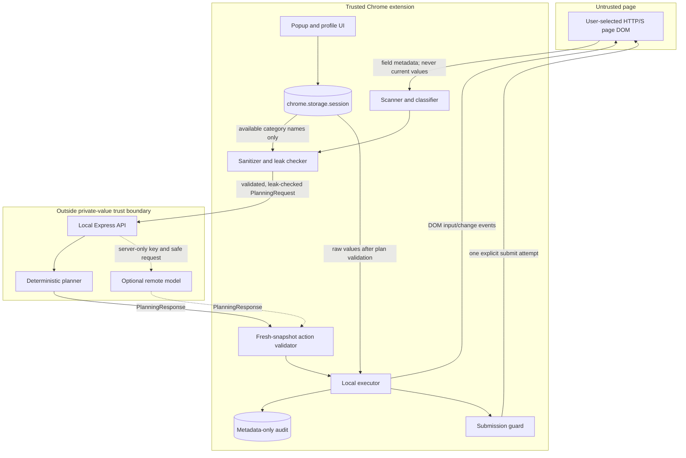

# PrivacyFill AI architecture

## Purpose

PrivacyFill AI fills supported application fields while keeping raw profile values out of the planning
service. The MVP deliberately separates semantic planning from secret handling: the planner can decide
that anonymous field `field_3` needs `PROFILE.EMAIL`, but only the trusted extension can resolve that
category to the session's actual email address.

## Trust-boundary diagram



Every destination page is untrusted, including the controlled localhost demos. The extension trusts its own packaged code
and temporary session storage. The Node.js server and any remote planner are intentionally treated as
unable to receive raw profile values.

## Components

| Component | Runtime | Responsibility | Must not receive or store |
| --- | --- | --- | --- |
| Profile page | Extension page | Validate and save seven fictional profile categories | API credentials |
| Session profile store | Extension service worker | Keep normalized values in `chrome.storage.session` | Persistent production secrets |
| Eligibility/injector | Extension popup | Validate the selected top-level HTTP/S tab and inject packaged scanner code only after a user click | Browser history, unselected tabs, child-frame contents |
| Content scanner and adapters | Extension isolated world | Discover supported native controls and build an in-memory field registry | Existing field values, page HTML, screenshots, account/page-wide text |
| PII classifier | Extension | Map safe labels/types to a supported profile category and risk | Profile values |
| Sanitizer and leak checker | Extension service worker | Construct the strict request and search it for protected-value variants | Unchecked outbound data |
| Popup | Extension page | Drive scan, inspect exact checked JSON, plan/fill and audit | Displaying saved values |
| Planner API | Local Node.js process | Validate request, rate-limit, log safe metadata and select planner | Browser profile or DOM registry |
| Fallback planner | Local Node.js process | Deterministically create typed actions | Raw private values |
| Remote adapter | Local Node.js process | Call an optional model using a server-only key and strict output shape | Browser profile values |
| Action validator | Extension content script | Correlate IDs/snapshot, enforce allowlists, risk and type rules | Unvalidated execution |
| Executor | Extension content script | Resolve `profileKey` locally and dispatch native input/change events | Arbitrary JavaScript or selectors from planner |
| Audit store | Extension service worker | Keep capped, session-only field/action/result metadata | Field values, labels, prompts or full plans |
| Submission guard | Extension content script | Intercept guarded form submission and grant one explicit bypass | Silent or reusable approval |

## End-to-end data flow

1. The user saves only fictional values. Validation normalizes them and stores them in
   `chrome.storage.session`; the popup receives readiness and category counts, not values.
2. Invoking the toolbar popup gives Chrome's temporary `activeTab` grant for the selected tab, but performs
   no scan. Only a later user click on **Scan** starts top-frame injection of the packaged, idempotent content
   scanner. Browser pages, stores, local files and non-HTTP(S) schemes fail before injection.
3. The generic adapter or tested Google Forms adapter discovers supported native controls. Bounded labels
   come from explicit/wrapping labels, ARIA references, fieldset legends, narrow question headings,
   placeholders or safe names—never page-wide text or current values.
4. External-page metadata is canonicalized and private-looking label/option content is redacted or omitted.
   The scanner assigns anonymous field/form IDs and a value-independent snapshot ID. Hostname, URL, title,
   account identity and adapter status remain local UI metadata.
5. The classifier suggests a `PROFILE.*` category and risk. Password/OTP-like fields become
   `UNKNOWN_SENSITIVE` and cannot be filled.
6. The background sanitizer creates a strict `PlanningRequest`. Only category names, anonymous IDs,
   safe labels/types/options and required/risk metadata are included.
7. The leak checker serializes the exact request and compares it with exact and normalized variants of
   every saved profile value. A match blocks the request before HTTP.
8. `POST /api/plan` rejects malformed, oversized or unknown properties. The fallback or optional remote
   planner returns a strict `PlanningResponse` containing allowlisted typed actions.
9. The extension validates the response contract, request ID and snapshot ID, then leak-checks the
   response as a second privacy boundary.
10. Immediately before execution, the content script rescans the page. It rejects stale snapshots,
   missing/disabled/readonly/incompatible targets, unknown actions, unavailable categories and critical
   fills without approval.
11. Only approved `fill_private` actions resolve a category through the local session profile. The executor
    writes the value to the registered DOM element and dispatches `input` and `change` events.
12. Metadata-only audit entries are stored locally. The guard intercepts the next normal form submission and permits
    exactly one attempt only after **Submit once**.

## Planning request contract (version 1)

Top-level properties are strict; additional properties are rejected.

| Property | Meaning | Privacy property |
| --- | --- | --- |
| `contractVersion` | Currently `1` | Prevents silent schema drift |
| `requestId` | Correlation identifier | Contains no user identity |
| `snapshotId` | Value-independent form-state digest | Detects stale plans without hashing field values |
| `task` | Fixed safe planning instruction | Must not contain user-entered data |
| `availableProfileKeys` | Present category names such as `PROFILE.EMAIL` | Reveals availability, never category values |
| `fields` | Up to 100 sanitized field records | No selectors, HTML, coordinates or current values |

Each field contains only `fieldId`, `formId`, `tag`, normalized `type`, safe `label`, `required`, safe
`options`, `suggestedProfileKey`, and `risk`.

Example shape (illustrative values only):

```json
{
  "contractVersion": 1,
  "requestId": "request-example",
  "snapshotId": "snapshot-example",
  "task": "Fill compatible application fields from available profile categories.",
  "availableProfileKeys": ["PROFILE.NAME", "PROFILE.EMAIL"],
  "fields": [
    {
      "fieldId": "field_1",
      "formId": "form_1",
      "tag": "input",
      "type": "email",
      "label": "Email address",
      "required": true,
      "options": [],
      "suggestedProfileKey": "PROFILE.EMAIL",
      "risk": "medium"
    }
  ]
}
```

## Planning response contract (version 1)

The response repeats the request and snapshot IDs, identifies `remote` or `fallback`, contains no more
than 100 actions, and must set `requiresConfirmation` to `true`.

Allowlisted actions:

| Action | Allowed properties | Local policy |
| --- | --- | --- |
| `fill_private` | `target`, `profileKey` | Resolves only a supported category after type/risk checks |
| `select` | `target`, `value` | Value must be an advertised safe option |
| `check` | `target`, `checked` | Target must be a compatible checkbox/radio |
| `focus` | `target` | Target must still exist |
| `request_confirmation` | optional safe `reason` | Does not itself authorize disclosure or submission |

The planner cannot send a literal private value in `fill_private`, a CSS selector, JavaScript, a click,
navigation, submission instruction, or an unknown property.

## Extension messages

All runtime operations use allowlisted message names from `shared/message-types.js`.

| Message | Direction | Result |
| --- | --- | --- |
| `PING_CONTENT_SCRIPT` | Popup → selected top-frame content script | Confirm packaged scanner readiness before/after injection |
| `PROFILE_SAVE`, `PROFILE_CLEAR`, `PROFILE_GET_STATUS` | Profile/popup → service worker | Manage or summarize temporary profile state |
| `SCAN_FORM` | Popup → content script | Return sanitized scan metadata |
| `GET_SANITIZED_PAYLOAD` | Popup → service worker | Return exact checked request plus zero-match summary |
| `PLAN_REQUEST` | Popup → service worker → backend | Return checked request and validated plan |
| `VALIDATE_AND_EXECUTE` | Popup → service worker → content script | Fresh validation, local fill and guard arming |
| `APPEND_AUDIT_EVENTS` | Content script → service worker | Persist bounded metadata-only events |
| `GET_AUDIT_LOG`, `CLEAR_AUDIT_LOG` | Popup → service worker | Display or clear safe audit events |
| `ARM_SUBMISSION_GUARD` | Reserved shared type | Submission guard is currently armed as part of execution |

Every response follows `{ ok, data, error }`; UI-visible errors use safe codes/messages rather than raw
exception or provider output.

## Failure and fallback behavior

- No saved profile, no supported fields or an invalid scan stops before planning.
- A tab navigation, reload, switch or material form mutation invalidates the old scan and requires rescan.
- Unsupported Google Forms widgets are counted and left for manual completion; section movement is manual.
- Any protected-value match returns `PRIVACY_LEAK_BLOCKED`; no request is sent.
- Invalid JSON, over-32 KB payloads, bad origin, rate limits and contract errors are rejected by the API.
- Remote timeout, network error or rejected output triggers a validated deterministic fallback plan.
- Stale DOM or correlation IDs, unsafe actions and missing approval stop before local resolution.
- Partial DOM execution failure disarms the submission guard and reports only safe audit metadata.
- Canceling the submission dialog changes nothing; **Submit once** grants exactly one attempt and rearms.

## Deployment boundary

The planner API and controlled demonstrations remain local: the server binds to `127.0.0.1` and the only
persistent manifest host permission is `http://localhost:8787/*`. Normal web-form access uses temporary
`activeTab` authorization after the user invokes the extension; there is no `<all_urls>`, broad HTTPS host
permission or all-sites static content script.

Release scope is deliberately narrower than “any form”: tested native HTML controls on user-selected
top-level HTTP/HTTPS pages, plus an experimental Google Forms subset. Cross-origin frames, browser pages,
local files, custom ARIA widgets, CAPTCHA, uploads and automated section navigation fail closed or require
manual completion. Live external compatibility remains a Chrome checklist item, not an automated claim.
