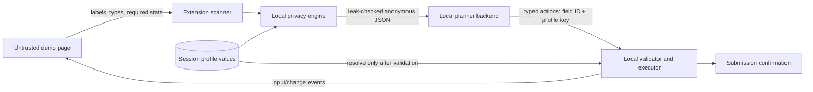

# PrivacyFill AI — SIH MVP 2026

PrivacyFill AI is a privacy-preserving Chrome form-filling agent. An AI or deterministic planner receives only anonymous field metadata and typed profile references; real profile values stay inside the trusted browser extension and are resolved locally.

The project is being implemented incrementally according to [IMPLEMENTATION_PLAN.md](./IMPLEMENTATION_PLAN.md).

## Architecture at a glance



The backend and optional remote model are outside the private-value trust boundary. See
[ARCHITECTURE.md](./ARCHITECTURE.md) for the component, message and contract details and
[THREAT_MODEL.md](./THREAT_MODEL.md) for the security assumptions and residual risks.

## Requirements

- Node.js 20 or newer
- npm
- A current Chromium-based browser (Chrome recommended)

## Current development commands

```bash
npm ci
npm test
npm run test:privacy
npm run test:acceptance
npm run verify:static
npm run verify:secrets
npm run verify:docs
npm run verify
```

Run the controlled demonstration forms at `http://localhost:8787/demo/`:

```bash
npm run server
```

The same process serves the demo forms and the planner API:

- `GET /api/health` reports the effective planner mode;
- `POST /api/plan` accepts only the sanitized planning-request contract;
- `GET /demo/*` serves the two controlled forms.

Fallback planning is the default and requires no API key. It deterministically returns typed
`fill_private` references for compatible fields and never receives or returns real profile values.

## Optional remote planning

Fallback planning is recommended for the hackathon demonstration because it is deterministic and needs
no key or network access. To test optional remote planning, create a local `.env` from `.env.example`:

```powershell
Copy-Item .env.example .env
```

Set `PLANNER_MODE=remote`, `OPENAI_API_KEY`, and `OPENAI_MODEL` inside `.env`, then restart
`npm run server`. Confirm the effective mode at `http://localhost:8787/api/health`. The key is read only
by the Node.js backend; never paste it into Chrome DevTools, profile fields, extension code, screenshots,
commits, or presentation slides.

The remote adapter requests structured JSON, revalidates the response, and automatically falls back on
timeout, network failure, malformed output, unsafe actions, or stale request identifiers.

## Build the Chrome extension

```bash
npm run build:extension
```

The loadable unpacked extension is generated at `dist/extension`. In Chrome, open
`chrome://extensions`, enable Developer mode, choose **Load unpacked**, and select that folder.

The current extension chunk provides:

- a session-only seven-field local profile;
- strict profile validation and normalization;
- a popup showing profile readiness without displaying values;
- a localhost-scoped DOM scanner with anonymous field IDs;
- deterministic PII classification and blocked OTP/password detection;
- value-independent form snapshot identifiers;
- an allowlist-only sanitized planning-request builder;
- exact and normalized profile-value leakage blocking;
- an exact checked-JSON payload viewer in the popup;
- validated calls to the local fallback or remote planner;
- a second local policy check against a fresh form snapshot;
- native field filling with `input` and `change` event dispatch;
- explicit approval before critical Aadhaar or PAN disclosure;
- session-only, metadata-only per-field audit records;
- a popup audit viewer with safe local clear controls;
- an extension-owned review dialog that intercepts submission;
- a one-use submission bypass that immediately rearms afterward;
- minimal localhost-only host access;
- no API credential or provider code in the browser bundle.

The popup can scan either controlled demo form and display the exact leak-checked JSON that would be
eligible to leave the extension. **Plan and fill locally** sends that checked object to the planner, validates
the returned action plan, asks before resolving critical identifiers, rescans for DOM changes, and fills
approved values inside the page's isolated extension context. OTP, password-like, unknown, stale, missing,
disabled, readonly and incompatible targets are rejected before execution. A filled form's next submit
attempt is intercepted by the extension and shows only the form name, filled-field count, and critical
category names. Cancel keeps the form editable; **Submit once** permits exactly one submission attempt.

For a local demonstration:

1. Run `npm run server` and `npm run build:extension`.
2. Load `dist/extension` as an unpacked Chrome extension.
3. Open the extension profile page, select **Use fictional demo profile**, and then select
   **Save to this session**. Do not use a team member's real data.
4. Open either controlled page:
   - Scholarship: `http://localhost:8787/demo/scholarship.html`
   - Citizen service: `http://localhost:8787/demo/service-registration.html`
5. Use **Scan**, optionally inspect the exact payload, then choose **Plan and fill locally**.
6. Approve the critical-identifier prompt and review the highlighted fields.
7. Choose **View privacy audit** to inspect value-free events.
8. Submit the form, review the extension confirmation dialog, then Cancel or **Submit once**.

Before presenting, follow the Chrome-only cases in
[`tests/manual/acceptance-checklist.md`](./tests/manual/acceptance-checklist.md) and record the operator,
Chrome version, and result for every row. Automated checks do not replace loading the unpacked extension
on the presentation laptop.

The complete five-minute narration, role split, reset sequence and failure recovery are in
[DEMO_SCRIPT.md](./DEMO_SCRIPT.md). Use [TEST_MATRIX.md](./TEST_MATRIX.md) to connect each claim to
automated or manual evidence. Store screenshots and the backup recording according to
[demo-evidence/README.md](./demo-evidence/README.md); that folder intentionally contains no real PII.

## Secret handling

Copy `.env.example` to `.env` only when remote backend configuration is required. Never commit `.env`,
place an API key in extension code, or use real personal information in tests. Server logs are restricted
to request ID, field count, planner type, duration, outcome, and a safe error code.

## Known MVP limitations

- It supports only the two localhost demonstration forms, not arbitrary websites or cross-origin frames.
- Classification is deterministic and label-driven; ambiguous or unfamiliar fields can be left unfilled.
- The seven-value profile uses temporary `chrome.storage.session`, not a production encrypted vault.
- Exact and normalized leak checks reduce accidental disclosure but are not a formal DLP guarantee.
- CAPTCHA, OTP, passwords, file uploads, screenshots, OCR and automatic final submission are excluded.
- A hostile page can observe values after they are inserted into its DOM; the MVP protects the planning
  boundary, not a page to which the user has intentionally chosen to disclose information.
- Remote-model behavior is probabilistic before validation; unapproved or malformed actions fail closed.

## Research acknowledgement and novelty boundary

The architecture is informed by Zhao, Li, Zou, Liu et al., *Anonymization-Enhanced Privacy Protection for
Mobile GUI Agents: Available but Invisible*, particularly its separation between anonymized agent
reasoning and trusted local resolution. The authors' accompanying research implementation is available at
[one-step-beh1nd/gui_privacy_protection](https://github.com/one-step-beh1nd/gui_privacy_protection).

PrivacyFill AI is not presented as inventing anonymization or the “available but invisible” principle. Its
defensible hackathon contribution is a constrained, inspectable Chrome form-filling realization: the user
can view the exact leak-checked request; the planner emits only schema-validated typed references; real
values are resolved after a fresh local policy check; offline fallback, metadata-only audit, and one-use
submission confirmation make the complete trust boundary demonstrable on ordinary web forms.

## Team handoff

Start with this README, then read these documents in order:

1. [ARCHITECTURE.md](./ARCHITECTURE.md) — what runs where and what data crosses each boundary.
2. [THREAT_MODEL.md](./THREAT_MODEL.md) — what is protected, assumed and still risky.
3. [DEMO_SCRIPT.md](./DEMO_SCRIPT.md) — the exact five-minute presentation and recovery path.
4. [TEST_MATRIX.md](./TEST_MATRIX.md) — claim-to-test traceability and evidence locations.
5. [Manual acceptance checklist](./tests/manual/acceptance-checklist.md) — Chrome release gate.
