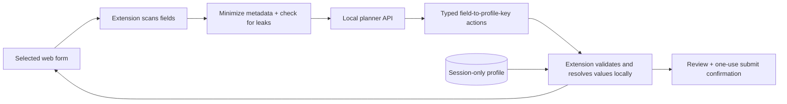

# PrivacyFill AI

### Fill forms faster. Keep personal data out of the planner.

**PrivacyFill AI** is our Smart India Hackathon MVP: a Chrome extension that helps people complete web forms while keeping their real profile values inside the browser. It scans a form, sends only minimized field descriptions and anonymous references to a planner, checks the proposed actions, and fills approved values locally. The user stays in control of sensitive fields and final submission.

> **The idea:** the planner can decide *which profile field goes where* without seeing *what the profile value is*.

## See it in action

The repository includes two controlled demo forms—a scholarship application and a citizen-service registration—plus a local planning API. Use fictional data for the demo.

## Requirements

- Node.js 20 or newer and npm
- A current Chromium-based browser (Chrome recommended)

1. Install [Node.js 20+](https://nodejs.org/) and run `npm ci`.
2. Start the demo server with `npm run server`. Visit [http://localhost:8787/demo/](http://localhost:8787/demo/).
3. In another terminal, run `npm run build:extension`.
4. Open `chrome://extensions` in Chrome, enable **Developer mode**, click **Load unpacked**, and select `dist/extension` from this repository.
5. Open the extension's profile page. Choose **Use fictional demo profile**, then **Save to this session**.
6. Open either demo form: [scholarship.html](./demo/scholarship.html) or [service-registration.html](./demo/service-registration.html). In the extension popup, choose **Scan**, inspect the exact privacy-checked payload, then choose **Plan and fill locally**.
7. Approve any critical-identifier prompt, review the filled fields and privacy audit, and try submitting. The extension asks for a final **Submit once** confirmation.

No API key is needed: the default planner is deterministic and runs on the local server. `GET /api/health` shows the active planner mode.

## What the MVP does

| Capability | How it works |
| --- | --- |
| On-demand form scanning | The user selects a tab; temporary `activeTab` access discovers eligible fields and blocks password/OTP-like targets. |
| Private planning | A leak check gates an allowlisted request containing field IDs, minimized labels, types, and profile-key references—not raw profile values. The popup shows the exact JSON before sending it. |
| Local execution | Planner actions are schema-validated against a fresh form snapshot; only then does the extension resolve session-held values and fill compatible fields. |
| User control | Critical identifiers such as Aadhaar and PAN require explicit approval. A metadata-only audit records actions, and a review dialog guards submission with a one-use bypass. |
| Wider form coverage | User-selected standard native HTML forms are supported on HTTP(S) pages. A Google Forms adapter supports a limited set of native text/date controls experimentally. |
| Visual inspection research | A separate inspector path explores local screenshot redaction, coverage checks, OCR, and bounded visual reasoning. It is guarded and does not turn screenshots into an unrestricted planner input. |

## Architecture at a glance



The planner backend is **outside** the private-value boundary. The selected webpage will, by necessity, see values once the user allows the extension to fill them. This design protects what is sent for planning; it does not make a form's recipient private.

## Run and verify

```bash
npm ci
npm run server             # demo pages + planner API on localhost:8787
npm run build:extension    # generates dist/extension
npm run verify             # tests, privacy/static/secret/documentation checks
```

Other focused commands: `npm run test:acceptance`, `npm run test:privacy`, `npm run verify:static`, and `npm run verify:secrets`. The server exposes `GET /api/health`, `POST /api/plan`, and `GET /demo/*`.

## Optional remote planning

The local fallback is the easiest and most predictable demo mode. For the optional remote planner, copy `.env.example` to `.env`, set `PLANNER_MODE=remote`, `OPENAI_API_KEY`, and `OPENAI_MODEL`, then restart the server. The key belongs only on the Node.js side; never put it in extension code or a commit. Remote responses are validated and fall back on timeout, malformed output, or unsafe actions. `.env` is ignored by Git.

## Project map

| Path | Purpose |
| --- | --- |
| [`extension/`](./extension/) | Manifest, popup, profile page, content scripts, privacy checks, local fill and visual inspector. |
| [`server/`](./server/) | Planner API, deterministic fallback and optional remote-model adapter. |
| [`shared/`](./shared/) | Contracts and types shared across the trust boundary. |
| [`demo/`](./demo/) | Controlled scholarship, citizen-service and distorted-form pages. |
| [`tests/`](./tests/) | Unit, integration, privacy and manual acceptance coverage. |
| [`scripts/`](./scripts/) | Build and security-verification tasks. |

For deeper detail, see [architecture](./ARCHITECTURE.md), [threat model](./THREAT_MODEL.md), [demo script](./DEMO_SCRIPT.md), [test matrix](./TEST_MATRIX.md), and the [visual browser-agent plan](./VISUAL_BROWSER_AGENT_IMPLEMENTATION_PLAN.md). The [manual acceptance checklist](./tests/manual/acceptance-checklist.md) and [external-page checklist](./tests/manual/external-page-checklist.md) are important before a live presentation.

## Known MVP limitations

- This is a prototype, not a production identity vault. The seven-field profile lives in temporary `chrome.storage.session` storage.
- Classification is label-driven, so unfamiliar or ambiguous fields may be left unfilled. Google Forms support is experimental; custom dropdowns, grids, uploads, and multi-section flows require manual work.
- Cross-origin iframe content, browser-internal pages, `file://` pages, passwords, OTPs, CAPTCHA, and automatic final submission are out of scope.
- Leak checks and local redaction lower accidental disclosure risk but are not a formal data-loss-prevention guarantee. Do not test with real personal data.
- Live-site compatibility needs manual verification; automated fixtures alone do not prove that a third-party page still works.

## Research acknowledgement and novelty boundary

The privacy boundary is informed by Zhao, Li, Zou, Liu et al., *Anonymization-Enhanced Privacy Protection for Mobile GUI Agents: Available but Invisible* ([research implementation](https://github.com/one-step-beh1nd/gui_privacy_protection)). Our contribution is an inspectable browser-form MVP: exact checked payload preview, typed references, fresh local validation, offline fallback, value-free audit, and explicit submission control. We do not claim to have invented anonymized agent reasoning.
